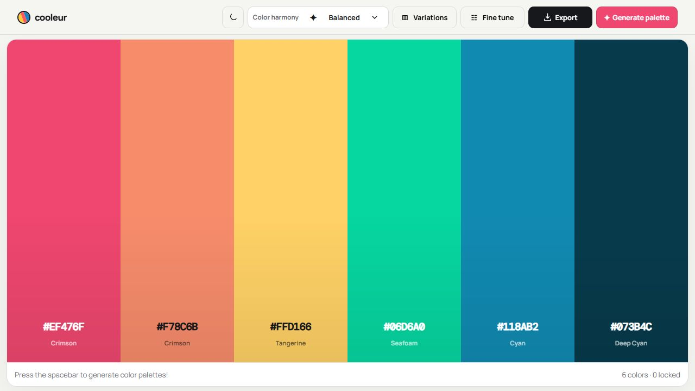

# Cooleur

> A browser-based palette studio for generating, refining, and exporting color palettes.

## Build a palette

- Generate a palette from a color harmony and lock swatches to keep them while you explore new combinations.
- Add, remove, or reorder colors. Use **Variations** and **Fine tune** to refine the palette.
- Copy hex values, explore shades, check contrast, or use **Export** to take the palette with you.

## License

[The Unlicense](./LICENSE)
